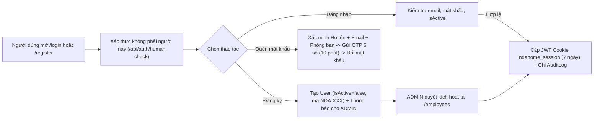
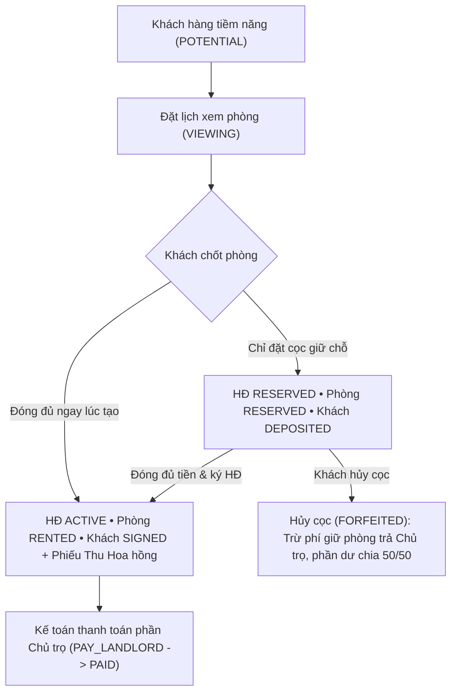
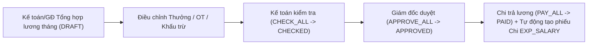

# Luồng Hoạt Động Toàn Bộ Hệ Thống NDAHOME Management

Tài liệu này mô tả chi tiết luồng hoạt động thực tế của từng chức năng và từng phân hệ (task) trong hệ thống **NDAHOME Management**, dựa trực tiếp trên mã nguồn API và phân quyền hiện tại.

---

## Tổng Quan Phân Quyền Theo Vai Trò

| Vai trò (`role`) | Mô tả | Các trang truy cập chính |
| :--- | :--- | :--- |
| **`ADMIN`** | Giám đốc (Toàn quyền duyệt & quản trị) | Tất cả module nội bộ (`/`, `/finance`, `/sales`, `/payroll`, `/attendance`, `/approvals`, `/it`, `/marketing`, `/employees`, `/recruitment`, `/profile`, `/audit`) |
| **`ACCOUNTANT`** | Kế toán (Kiểm tra số liệu, thu chi, lương, công) | `/`, `/finance`, `/sales`, `/payroll`, `/attendance`, `/approvals`, `/employees` (chỉ xem), `/profile` |
| **`SALES`** | Nhân viên Kinh doanh / Sales | `/`, `/sales`, `/attendance`, `/approvals`, `/profile` |
| **`IT`** | Nhân viên IT | `/`, `/it`, `/attendance`, `/approvals`, `/profile` |
| **`MARKETING`** | Nhân viên Marketing | `/`, `/marketing`, `/attendance`, `/approvals`, `/profile` |
| **`LANDLORD`** | Chủ trọ / Đối tác | `/landlord`, `/landlord/utilities`, `/landlord/operations`, `/profile` |

---

## 1. Xác Thực & Quản Lý Tài Khoản (`/login`, `/register`, `/forgot-password`)



- **Đăng nhập (`/login` -> `POST /api/auth/login`)**:
  1. Bắt buộc vượt qua widget xác nhận người máy (`humanToken`).
  2. Kiểm tra email, trạng thái `isActive` (nếu `false` sẽ chặn và báo chờ Admin duyệt) và mật khẩu (bcrypt).
  3. Sinh JWT (`ndahome_session`, hạn 7 ngày), lưu cookie `httpOnly` và ghi nhận `LOGIN` vào `AuditLog`.
- **Đăng ký tài khoản (`/register` -> `POST /api/auth/register`)**:
  1. Nhân sự mới nhập họ tên, email, mật khẩu (tối thiểu 6 ký tự), SĐT, phòng ban, loại hình (`FULL_TIME` / `INTERN`).
  2. Hệ thống tự sinh mã nhân viên tiếp theo (`NDA-XXX`), đặt `isActive: false` và gửi `Notification` cho các tài khoản `ADMIN`.
  3. Chỉ đăng nhập được sau khi `ADMIN` vào `/employees` bấm duyệt kích hoạt.
- **Quên mật khẩu (`/forgot-password` -> `POST /api/auth/forgot-password`)**:
  1. **Bước 1 (`REQUEST_OTP`)**: Người dùng nhập Họ tên + Email + Phòng ban; hệ thống đối chiếu khớp với DB rồi sinh OTP 6 số (hiệu lực 10 phút, lưu tại `data/password-reset-otps.json`). Nếu có `SMTP_USER`/`SMTP_PASS` sẽ gửi qua Gmail, nếu chưa có sẽ trả OTP demo để test.
  2. **Bước 2 (`RESET_PASSWORD`)**: Xác thực OTP còn hạn, cập nhật `passwordHash` mới và xóa OTP đã dùng.

---

## 2. Dashboard Tổng Quan (`/`)

- Hiển thị số liệu tổng hợp theo thời gian thực từ `/api/dashboard` (doanh thu, thu/chi, công nợ, hợp đồng, phòng trống, nhân sự, thông báo cá nhân).
- Dữ liệu và các thẻ truy cập nhanh tự động co giãn theo `role` đang đăng nhập.

---

## 3. Thu Chi & Công Nợ (`/finance`)

- **Phạm vi dữ liệu**: `ADMIN` và `ACCOUNTANT` xem toàn công ty; nhân viên phòng ban khác chỉ xem giao dịch của phòng mình hoặc do mình tạo.
- **Luồng tạo giao dịch (`POST /api/finance/transactions`)**:
  1. Nhập loại (`INCOME` Thu / `EXPENSE` Chi), danh mục, phòng ban, số tiền, ngày giao dịch, ghi chú công nợ (`isDebt`) và ảnh chứng từ (`voucherUrl`).
  2. Hệ thống tự cấp mã `TC-...`.
     - Nếu người tạo là `ADMIN` hoặc `ACCOUNTANT`: mặc định `approvalStatus = APPROVED`, `paymentStatus = PAID`.
     - Nếu nhân viên thường tạo: mặc định `approvalStatus = PENDING`, `paymentStatus = UNPAID`.
  3. **Liên kết tự động Ngân sách**: Nếu là giao dịch `EXPENSE` và phòng ban đó đã có `DepartmentBudget` trong tháng/năm tương ứng, hệ thống tự động cộng vào `usedAmount`, tạo bản ghi `BudgetExpense`, và đổi trạng thái ngân sách sang `EXCEEDED` nếu vượt hạn mức.
- **Luồng cập nhật & thanh toán (`PATCH /api/finance/transactions`)**:
  - Người tạo hoặc Tài chính có thể đính kèm/scan bổ sung chứng từ (`UPLOAD_VOUCHER`).
  - `ADMIN`/`ACCOUNTANT` duyệt trạng thái (`approvalStatus`), xác nhận thanh toán (`paymentStatus = PAID`) -> tự động sinh `PaymentRecord` (tiền mặt hoặc chuyển khoản) và ghi `AuditLog`.

---

## 4. Sales, CRM, Đặt Lịch & Hợp Đồng (`/sales`)



- **Quản lý CRM & Quỹ phòng (`POST /api/sales/crm`)**:
  - Tạo & theo dõi Khách hàng (`Customer`), Khu nhà (`Property`), Phòng (`Room`).
  - **Đặt lịch xem phòng (`VIEWING`)**: Lưu lịch hẹn vào `data/room-viewings.json`, hỗ trợ chọn lịch **tự dẫn** hoặc **phối hợp Sales Online – Sales Offline**.
- **Tạo Hợp đồng / Phiếu cọc (`POST /api/sales/contracts`)**:
  1. Chọn khách hàng, phòng, thời hạn (`6` tháng hoặc `12` tháng), tiền thuê, tiền cọc.
  2. **Công thức hoa hồng công ty**:
     - Hợp đồng `6` tháng: hoa hồng công ty = **50%** tiền cọc.
     - Hợp đồng `12` tháng: hoa hồng công ty = **70% – 100%** tiền cọc (mặc định 80%).
     - Phần còn lại (`depositAmount - companyRevenue`) là `landlordPayable` (tiền phải trả chủ trọ).
  3. **Chia hoa hồng Sales phối hợp**: Nếu có `onlineSalesId` khác `offlineSalesId`, hệ thống lưu tỷ lệ chia **50% / 50%** vào `contractSplits` để tính KPI và lương cho cả 2 Sales.
  4. **Trạng thái khi tạo**:
     - Nếu không phải giữ cọc và thu đủ (`collectedAmount >= depositAmount`): Hợp đồng `ACTIVE`, Phòng `RENTED`, Khách `SIGNED`, và tự động tạo giao dịch Thu `INC_COMMISSION` vào sổ Thu Chi.
     - Nếu chỉ đặt cọc (`isDepositOnly`) hoặc thu một phần: Hợp đồng `RESERVED`, Phòng `RESERVED`, Khách `DEPOSITED`.
- **Các nghiệp vụ sau tạo hợp đồng (`PATCH /api/sales/contracts`)**:
  - `SIGN_AND_RENT`: Khách đóng đủ phần còn lại và ký chính thức -> chuyển HĐ sang `ACTIVE`, Phòng sang `RENTED`, Khách sang `SIGNED`, tạo phiếu Thu hoa hồng.
  - `COLLECT_DEPOSIT`: Cập nhật số tiền cọc thu từng phần (`PARTIAL` / `COLLECTED`).
  - `CANCEL_DEPOSIT` (Hủy cọc):
    1. Tính tiền giữ phòng trả chủ trọ = `(monthlyRent / 30) * holdDays` (tối đa bằng số cọc đã thu).
    2. Phần tiền cọc còn dư (`remainingPool`) chia **50% cho Chủ trọ**, **50% cho Sales/Công ty**.
    3. Hợp đồng chuyển sang `FORFEITED`, Phòng mở lại `AVAILABLE`, Khách về `POTENTIAL`, và tự động ghi phiếu Thu nếu phần công ty hưởng > 0.
  - `PAY_LANDLORD`: Chỉ `ADMIN`/`ACCOUNTANT` thực hiện để xác nhận đã chuyển trả `landlordShare` cho chủ trọ (`landlordPayoutStatus = PAID`).
  - `UPLOAD_INVOICE`: Tải ảnh chụp hóa đơn/chứng từ hợp đồng.
- **Đua Top KPI Sales (`/api/sales/top-kpi-reward`)**:
  - Xếp hạng Sales theo `% KPI` đạt được từ các hợp đồng `ACTIVE` và `FORFEITED` (có tính chia 50/50). Sales đứng Top 1 với doanh thu > 0 được mở vòng quay/bốc thăm nhận thưởng tháng.

---

## 5. Cổng Chủ Trọ (`/landlord`, `/landlord/utilities`, `/landlord/operations`)

Dành riêng cho tài khoản `role === "LANDLORD"`:

1. **Cổng Chủ trọ & Phòng (`/landlord` -> `/api/landlord`)**:
   - Xem thống kê tổng khu nhà, tổng phòng theo trạng thái (`AVAILABLE`, `RESERVED`, `RENTED`, `MAINTENANCE`).
   - Xem tổng tiền phần chủ trọ (`totalLandlordShare`), số tiền công ty đã thanh toán (`paidToLandlord`) và còn phải thu (`unpaidToLandlord`).
   - Tự thêm hoặc cập nhật thông tin Khu nhà (`PROPERTY`) và Phòng (`ROOM`).
2. **Điện – Nước & Tiền phòng (`/landlord/utilities` -> `/api/landlord/extras`)**:
   - Nhập chỉ số Điện cũ/mới, Nước cũ/mới, đơn giá điện/nước, phí dịch vụ và tiền phòng theo từng tháng (`YYYY-MM`).
   - Hệ thống tự tính tổng hóa đơn (`totalAmount`), lưu trạng thái đã thu/chưa thu (`isPaid`) và hỗ trợ in phiếu thu tiền phòng.
3. **Cư dân, Tạm trú & Vận hành (`/landlord/operations` -> `/api/landlord/extras`)**:
   - Quản lý danh sách cư dân đang ở (SĐT, CCCD, biển số xe, mã thẻ từ, trạng thái đăng ký tạm trú).
   - Ghi nhận sự cố bảo trì phòng (`OPEN`/`DONE`, chi phí sửa chữa), lịch báo trả phòng (`VacatingNotice`), cấu hình đơn giá mặc định theo khu nhà và chi phí vận hành hàng tháng.

---

## 6. Ngân Sách & Phê Duyệt (`/approvals`, `/budgets`)

Gồm 2 luồng song song tại giao diện Ngân sách & Phê duyệt:

```mermaid
flowchart LR
    subgraph Luồng 1: Đề xuất Phê duyệt & Quyết toán (DX-...)
      A1["Nhân viên tạo Đề xuất (PENDING)"] --> A2["Kế toán kiểm tra (ACCOUNTANT_CHECKED)"]
      A2 --> A3["Giám đốc duyệt & chốt hạn mức (APPROVED)"]
      A3 --> A4["Thêm khoản chi + hóa đơn (ADD_EXPENSE)"]
      A4 --> A5["Gửi quyết toán (SETTLEMENT_PENDING)"]
      A5 --> A6["Kế toán/GĐ duyệt đóng (CLOSED)"]
    end

    subgraph Luồng 2: Ngân sách Phòng ban (NS-...)
      B1["Tạo Đề xuất Ngân sách (PENDING)"] --> B2["Kế toán kiểm tra (ACCOUNTANT_CHECKED)"]
      B2 --> B3["Giám đốc duyệt (APPROVED)"]
      B3 --> B4["Sinh gói DepartmentBudget (ACTIVE) & tự trừ khi có phiếu Chi"]
    end
```

- **Luồng Đề xuất & Quyết toán (`/api/approvals`)**:
  1. Nhân viên tạo đề xuất (`DX-...`: Mua sắm, Chi phí, Dự án, Bổ sung ngân sách, Thanh toán...).
  2. Kế toán/Giám đốc kiểm tra (`CHECK` -> `ACCOUNTANT_CHECKED`).
  3. Giám đốc phê duyệt (`APPROVE` -> `APPROVED`, có thể điều chỉnh số tiền được duyệt `approvedAmount` và ghi chú).
  4. Trong quá trình thực hiện, người tạo/phòng ban/tài chính thêm từng khoản chi thực tế kèm hóa đơn minh chứng (`ADD_EXPENSE`), hệ thống tự cộng dồn `actualSpent`.
  5. Khi hoàn tất, gửi quyết toán (`SUBMIT_SETTLEMENT` -> `SETTLEMENT_PENDING`) và bắn thông báo cho `ADMIN`/`ACCOUNTANT`.
  6. Kế toán/Giám đốc kiểm tra đối chiếu `approvedAmount` vs `actualSpent` và bấm duyệt đóng (`APPROVE_SETTLEMENT` -> `CLOSED`).
- **Luồng Ngân sách Phòng ban (`/api/budgets`)**:
  1. Phòng ban gửi đề xuất ngân sách (`NS-...` -> `PENDING`).
  2. Kế toán kiểm tra số liệu (`ACCOUNTANT_CHECK` -> `ACCOUNTANT_CHECKED`).
  3. Giám đốc duyệt (`APPROVE` -> `APPROVED`): tự động tạo `DepartmentBudget` cho tháng/năm của kỳ ngân sách; từ đó mọi giao dịch Chi (`EXPENSE`) của phòng ban trong tháng đó sẽ tự động trừ vào gói ngân sách này.
  4. Giám đốc cũng có quyền Từ chối (`REJECTED`), Yêu cầu chỉnh sửa (`REVISION_REQUESTED`), hoặc xóa đề xuất.

---

## 7. Chấm Công & Nghỉ Phép (`/attendance`)

- **Phạm vi xem**: Nhân viên thường xem công & đơn của cá nhân; `ADMIN`/`ACCOUNTANT` có thể xem toàn công ty (`scope=all`).
- **Nhân viên tự chấm công (`POST /api/attendance`)**:
  - `CHECK_IN`: Ghi nhận giờ vào; nếu sau **08:15** hệ thống tự gắn trạng thái `LATE`, ngược lại là `PRESENT`. Mỗi ngày chỉ Check-in 1 lần.
  - `CHECK_OUT`: Tính tổng giờ làm (`workHours`) và giờ tăng ca (`overtimeHours`, tính phần vượt quá 8.5 giờ).
- **Đơn từ cá nhân**:
  - `LEAVE_REQUEST`: Tạo đơn xin nghỉ phép (kèm ảnh minh chứng `evidenceUrl` nếu có).
  - `ADJUSTMENT_REQUEST`: Tạo đơn giải trình/điều chỉnh giờ vào–ra khi quên chấm công.
- **Quản lý & Chốt công (`POST`/`PATCH /api/attendance`)**:
  - Riêng `ADMIN` có quyền chấm công hộ cho từng nhân sự (`ADMIN_MARK_ATTENDANCE`, tự động `isConfirmed = true`).
  - `ADMIN`/`ACCOUNTANT` thực hiện: xác nhận từng dòng công (`CONFIRM_ATTENDANCE`), duyệt/từ chối đơn nghỉ phép (`REVIEW_LEAVE`), duyệt/từ chối đơn điều chỉnh công (`REVIEW_ADJUSTMENT`), và **Chốt bảng công tháng (`LOCK_MONTH`)**.

---

## 8. Quản Lý Lương & Hoa Hồng (`/payroll`) và Hồ Sơ Cá Nhân (`/profile`)



- **Tổng hợp bảng lương (`POST /api/payroll`)**:
  - Chỉ `ADMIN`/`ACCOUNTANT` thực hiện.
  - **Đối với Sales**: Lấy tổng doanh số công ty từ các hợp đồng `ACTIVE` & `FORFEITED` trong tháng (có áp dụng chia 50/50 theo `contractSplits`), tính hoa hồng theo bậc (`calculateSalesCommission`) + phụ cấp.
  - **Đối với phòng ban khác**: Tính theo `baseSalary + allowance`.
- **Điều chỉnh & Quy trình duyệt (`PATCH /api/payroll`)**:
  1. `UPDATE_ADJUSTMENTS`: Cập nhật thưởng (`bonus`), tăng ca (`overtimePay`), khấu trừ (`deduction`), tự tính lại `grossIncome` và `netSalary`.
  2. `CHECK_ALL`: Kế toán xác nhận toàn bộ dòng `DRAFT` -> `CHECKED`.
  3. `APPROVE_ALL`: Chỉ `ADMIN` (Giám đốc) duyệt -> `APPROVED`.
  4. `PAY_ALL`: Chuyển toàn bộ bảng lương đã duyệt sang `PAID`, ghi nhận `paidAt`, và **tự động tạo 1 phiếu Chi `EXP_SALARY`** bên module Thu Chi bằng tổng số tiền thực nhận.
  5. Hỗ trợ đính kèm/scan bảng lương đã ký cả tháng (`UPLOAD_PAYROLL_DOC`) hoặc chứng từ từng nhân sự (`UPLOAD_ROW_ATTACHMENT`), và in phiếu lương.
- **Hồ sơ & Lương cá nhân (`/profile`)**:
  - Mọi nhân sự xem thông tin cá nhân, bảng lương tháng hiện tại và lịch sử các tháng trước của riêng mình.

---

## 9. Phòng IT & Dự Án (`/it`)

- **Phạm vi**: `ADMIN` và `IT`.
- **Chức năng (`/api/departments/it`)**:
  - **Dự án (`PROJECT` - `PRJ-...`)**: Nếu `ADMIN` tạo sẽ vào thẳng `IN_PROGRESS`; nhân viên tạo sẽ ở `PENDING_APPROVAL`. Cho phép cập nhật trạng thái và `%` tiến độ (`progress`).
  - **Công việc (`TASK`)**: Tạo task gắn với dự án/phòng ban/người phụ trách (mặc định `TODO`) và cập nhật trạng thái (`TODO` -> `IN_PROGRESS` -> `REVIEW` -> `DONE`).
  - **Thiết bị IT (`DEVICE` - `DEV-...`)**: Quản lý tài sản IT (Laptop, Monitor, Server...), tự động đặt `IN_USE` nếu đã gán cho nhân sự hoặc `AVAILABLE` nếu còn trong kho.

---

## 10. Phòng Marketing (`/marketing`)

- **Phạm vi**: `ADMIN` và `MARKETING`.
- **Chức năng (`/api/departments/marketing`)**:
  - Tạo & theo dõi các Chiến dịch Marketing (`MKT-...`) theo kênh (`FACEBOOK_ADS`, `TIKTOK_ADS`, `GOOGLE_ADS`, `CONTENT`, `SEO`), ngân sách, chi phí đã chạy (`spent`), số lượng Leads và Conversions.
  - Đồng bộ danh sách Lead khách hàng đổ về từ nguồn `FACEBOOK` và `TIKTOK` để theo dõi chuyển đổi sang Sales.

---

## 11. Quản Trị Nhân Sự, Tuyển Dụng & Nhật Ký Hệ Thống (`/employees`, `/recruitment`, `/audit`)

1. **Nhân sự & Phân quyền (`/employees` -> `/api/employees`)**:
   - `ADMIN` và `ACCOUNTANT` được xem danh sách nhân sự & phòng ban.
   - Chỉ `ADMIN` mới có quyền: thêm nhân sự trực tiếp, **duyệt kích hoạt tài khoản tự đăng ký (`isActive = true` + gửi thông báo)**, **từ chối/xóa tài khoản đang chờ duyệt**, phân quyền `role`, `isTeamLead`, cập nhật lương cơ bản, phụ cấp, KPI.
2. **Hồ sơ & Lương Giám đốc (`/recruitment` -> `/api/recruitment`)**:
   - Chỉ `ADMIN` truy cập.
   - Quản lý hồ sơ ứng viên (`UV-...`), lịch phỏng vấn, CV.
   - **Nhận việc (`ONBOARD`)**: Chuyển 1 ứng viên thành `User` chính thức (tự cấp mã `NDA-XXX`, mật khẩu mặc định `123456`, map phòng ban/vai trò) và đổi trạng thái ứng viên sang `ONBOARDED`.
   - **Cập nhật lương trực tiếp (`MEMBER_SALARY`)**: Giám đốc điều chỉnh nhanh lương cơ bản, phụ cấp, KPI, vị trí hoặc thông tin thực tập sinh của từng nhân sự.
3. **Nhật ký Hệ thống (`/audit`)**:
   - Chỉ `ADMIN` truy cập để tra cứu toàn bộ lịch sử thao tác quan trọng (`AuditLog`: đăng nhập, tạo/duyệt giao dịch, hợp đồng, hủy cọc, chốt công, duyệt lương, phân quyền...).
